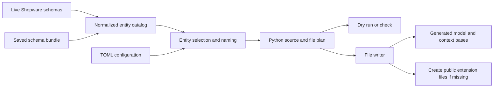

# Python scaffolder proposal

Status: implemented as a local tool, 13 October 2026. This document records the
design; the [tool README](../tools/scaffolder/README.md) documents the current
commands and limitations. Registry publication remains future work, so use the
local `uv run shopware-admin-scaffold` entry point in place of `uvx` below.

## Recommendation and package boundary

Build `shopware-admin-scaffold` as a separate Python distribution in the same
repository as `shopware-admin-python`, under `tools/scaffolder/`. Publish the tool
independently and install it as a development dependency or run it with `uvx`.
Generated code belongs to the consuming application's package.

| Option | Assessment |
| --- | --- |
| Generator inside the runtime distribution | Convenient installation, but couples schema discovery, CLI releases, and generation dependencies to every application. Conflicts with the current runtime boundary in `AGENTS.md`. |
| Separate distribution, same repository | Recommended. Independent installation with shared ownership, coordinated contract tests, and straightforward local development. |
| Separate repository | Possible later, but adds release and compatibility coordination before there is a reason for separate ownership. |

The tool should declare a supported runtime version range, initially aligned with
the `0.1` model contract, and record that range in generated metadata. Depend on
the runtime to test emitted code, and use only its public APIs. The runtime must
never depend on the tool. Its existing wheel remains limited to `src/shopware_admin`.
Keep the tool's own `pyproject.toml`, lockfile, source, and tests together; use an
editable local runtime dependency for development and a versioned dependency for
distribution. Start with stdlib `argparse`, `json`, `tomllib`, and HTTPX rather than
introducing a template engine or an additional model framework.

```text
shopware-admin-python/
  src/shopware_admin/                 # Existing runtime
  tools/scaffolder/
    pyproject.toml                   # Distribution: shopware-admin-scaffold
    src/shopware_admin_scaffold/
      cli.py
      schema_client.py
      catalog.py
      selection.py
      naming.py
      generator.py
      writer.py
    tests/
```

## What the existing implementations establish

The [.NET scaffolder](../../Shopware.DirectShop/tools/ShopwareApiScaffolder/README.md)
already separates schema HTTP access, catalog parsing/selection, command-line
options, and C# generation. It is packaged as a tool rather than part of
`Shopware.AdminApi`. It preserves exact API routes, discovers plugin entities,
supports explicit selections or all entities, optionally expands one association
level, and generates a context only when requested. Existing files require `--force`.
Its models and context use partial classes for handwritten extensions.

The Python [model and context contract](../README.md) is ready for a generator:
`Entity`, `Field`, `ToOne`, `ToMany`, and `entity_set()` supply both instance values
and typed queries. `Context` inherits `Client`; it registers declared public model
classes before repositories are accessed. `ModelRegistry` can hydrate associations
declared against a base into registered public subclasses. Python needs separate
base/subclass files in place of C# partial classes.

Reuse the .NET workflow and selection semantics, but emit Python descriptors rather
than porting C# property rules. Python distinguishes constructor omission, JSON
nullability, and creation requirements; absent response fields do not require every
scalar to become nullable. A Python context also needs no generated constructor or
equivalent of the .NET `OnCreated` hook.

## Architecture and schema input



Use two inputs from the same shop:

- OpenAPI at `/api/_info/openapi3.json?type=jsonapi` for exposed entity endpoints,
  exact routes, schema references, wire types, and nullability. This matches the
  endpoint requested by the existing .NET tool.
- DAL metadata at `/api/_info/entity-schema.json` for actual entity identities,
  association targets/cardinality, field flags, and protections.

Shopware's [InfoController](https://github.com/shopware/core/blob/trunk/Framework/Api/Controller/InfoController.php)
exposes these two routes. Its
[EntitySchemaGenerator](https://raw.githubusercontent.com/shopware/core/trunk/Framework/Api/ApiDefinition/Generator/EntitySchemaGenerator.php)
emits entity names, field flags, association relations, and read/write protections.
This metadata can help distinguish an entity association from an ordinary object
reference. These are design inputs, not a guarantee that every Shopware version
exposes identical schemas; verify them against saved fixtures from the supported
versions before implementation is accepted.

OpenAPI determines what the Admin API exposes; DAL metadata enriches that surface.
Do not expose every DAL field merely because it exists. Preserve the exact route
from OpenAPI instead of deriving it from a Python class name. Resolve and flatten
supported local schema references/compositions, and associate them with DAL entity
identities. Endpoint response envelopes describe transport, not extra entity fields.
Prefer explicit references/metadata over relying solely on `get{Name}List`
operation IDs, as the current .NET catalog does. Report ambiguous joins rather
than silently choosing a route or target.

The normalized catalog should have `EntitySpec` and `FieldSpec` records containing
entity/route/schema names, wire paths, Python names, value types, scalar versus
association kind, target/cardinality, nullable state, writable state, and separate
creation requirements. Keep schema normalization, entity selection, source
rendering, and filesystem writes independently testable.

`SchemaClient` owns HTTPX, integration authentication, timeouts, and schema requests.
Use the same credential environment variable names as .NET. It should not reach
into `Client._connection`: the current public `Client.request()` rejects query
parameters and requires authentication, whereas discovery may be anonymous.
Keep this small HTTP adapter in the tool rather than changing runtime transport
just for generation. A supplied credential pair or access token must be used;
authentication failure must not silently fall back to anonymous access.

A snapshot bundle contains `openapi.json`, `entity-schema.json`, and provenance
metadata with content hashes and the Shopware version when available. Offline
generation must require no network. Credentials never belong in that bundle.
Initially require both schema inputs; defer a reduced OpenAPI-only mode until its
limitations have a deliberate contract.

## Proposed CLI

Use a console entry point named `shopware-admin-scaffold`, with subcommands:

```bash
# Discover exact entity, route, and proposed Python class names
uvx shopware-admin-scaffold list \
  --url http://127.0.0.1:8000 --filter customer

# Generate an application package from a live shop
uvx shopware-admin-scaffold generate \
  --url http://127.0.0.1:8000 \
  --output ./src/my_shop_api --package my_shop_api \
  --entity customer --entity country \
  --scaffold-related --context ShopContext

# Save both schemas, then regenerate offline from a reviewed configuration
uvx shopware-admin-scaffold snapshot \
  --url http://127.0.0.1:8000 --output ./schemas/shopware

uvx shopware-admin-scaffold generate --config shopware-scaffold.toml --dry-run
uvx shopware-admin-scaffold generate --config shopware-scaffold.toml --force
uvx shopware-admin-scaffold generate --config shopware-scaffold.toml --check
```

| Interface | Contract |
| --- | --- |
| `--url` / `--schema-dir` | Exactly one live or offline source, also configurable in TOML. |
| `list --filter` | Sorted discovery across entity, route, and class names; no source files generated. Optional JSON output for scripting. |
| `--entity` / `--all` | Explicit selection; repeat `--entity` or accept comma-separated names. No implicit all-entity generation. |
| `--scaffold-related` | Add targets directly related to the explicit selection, once, without recursion; same behavior as .NET. |
| `--output` | Filesystem directory containing the target application package. No `.csproj` equivalent required. |
| `--package` | Dotted import name for that package; necessary because a filesystem path does not establish its import name. |
| `--context ShopContext` | Generate `ShopContextBase` and create a public `ShopContext` shell if missing. Without it, generate models only. |
| `--dry-run` | Show selected entities, omitted associations, diagnostics, and file changes without writes. Live sources still require HTTP. |
| `--force` | Replace tool-owned generated files only; never replace public extension files. |
| `--check` | Compare the intended output with existing files without writing; nonzero if generated files differ or required public files are missing. |

Use `SHOPWARE_API_CLIENT_ID` and `SHOPWARE_API_CLIENT_SECRET`, with an optional
`SHOPWARE_API_ACCESS_TOKEN` alternative. Conflicting/incomplete authentication
settings are errors. TOML contains no credentials. Resolve paths relative to the
configuration file, and let explicit CLI options override its values. Pin the
generator version in a project's development lockfile for repeatable generation;
unversioned `uvx` above only illustrates the interface.

```toml
schema_dir = "schemas/shopware"
output = "src/my_shop_api"
package = "my_shop_api"
entities = ["product", "category", "product_manufacturer"]
scaffold_related = false
context = "ShopContext"

[entity.product]
class_name = "Product"
set_name = "products"

[entity.category]
set_name = "categories"

[entity.product_manufacturer]
class_name = "Manufacturer"
set_name = "manufacturers"

[field.product.stock]
required_on_create = true
```

Convert field names to snake_case and model names to PascalCase while preserving
wire aliases. Make common context set plurals readable, allow explicit overrides,
and persist the chosen names in the generation manifest. Check Python keywords,
runtime members such as `raw_data`, `set`, and `context`, and all naming collisions
before writing. Never silently rename a public symbol on regeneration. Configuration
should also support field-name, nullability, and writable-state overrides where
schema evidence is insufficient; diagnostics must show when an override is used.

## Generated code and extension ownership

```text
src/my_shop_api/
  __init__.py                       # Created if absent; never rewritten
  models/
    __init__.py                     # Created if absent; no managed re-export list
    product.py                      # Public Product; create once
    category.py                     # Public Category; create once
    manufacturer.py                 # Public Manufacturer; create once
  context.py                        # Public ShopContext; create once
  _generated/
    __init__.py
    model_bases.py                  # All selected entity bases; regenerated
    context_base.py                 # Imports public model classes; regenerated
    manifest.json                   # Tool/runtime contract, names, hashes, ownership
```

Keep all generated model bases in one module for the first version. This makes
self-references and cyclic Shopware association graphs manageable without a graph
of eagerly imported base modules. Public model classes can stay in individual
files; the generated context imports those files directly, so adding an entity
does not require rewriting a handwritten `models/__init__.py`.

Example generated declarations, shortened for illustration:

```python
# _generated/model_bases.py
from __future__ import annotations

from shopware_admin import Entity, Field, ToMany, ToOne, api_field, to_many, to_one


class ProductBase(Entity):
    __entity__ = "product"
    __route__ = "product"

    id: Field[str] = api_field("id", default=None)
    stock: Field[int] = api_field("stock", default=None, required_on_create=True)
    manufacturer: ToOne[public_manufacturer.Manufacturer] = to_one("manufacturer")
    categories: ToMany[public_category.Category] = to_many("categories")


# CategoryBase, ManufacturerBase, and the other selected bases are defined here.
# Import public modules only AFTER every generated base has been declared.
from ..models import category as public_category  # noqa: E402
from ..models import manufacturer as public_manufacturer  # noqa: E402
```

```python
# models/product.py: initially created by the tool, subsequently user-owned
from shopware_admin import Field, api_field

from .._generated.model_bases import ProductBase


class Product(ProductBase):
    erp_reference: Field[str | None] = api_field(
        json_path=("customFields", "erp_reference"),
        criteria_path="customFields.erp_reference",
        default=None,
    )
```

```python
# _generated/context_base.py
from shopware_admin import Context, entity_set

from ..models.category import Category
from ..models.manufacturer import Manufacturer
from ..models.product import Product


class ShopContextBase(Context):
    products = entity_set(Product)
    categories = entity_set(Category)
    manufacturers = entity_set(Manufacturer)
```

```python
# context.py: initially created as a shell, subsequently user-owned
from ._generated.context_base import ShopContextBase


class ShopContext(ShopContextBase):
    pass
```

Association annotations should name the **public model types**, not only their
bases. Registering public subclasses fixes runtime hydration, but it does not
change static annotations: a declaration of `ToOne[ManufacturerBase]` would still
hide custom manufacturer fields from autocomplete and type checking.

Use postponed annotations and the public module aliases imported at the end of
the generated base module. The current runtime resolves annotations lazily with
`get_type_hints()`, so the aliases must actually exist at runtime; imports only
under `TYPE_CHECKING` are insufficient. Importing modules after all base definitions
allows the public classes to inherit those bases in either import order. Model
modules must finish declaring their classes before any code evaluates association
annotations or builds association queries. Package initializers should remain
minimal to avoid premature evaluation.

A scratch proof of this arrangement passed four entry-point import orders,
self-references and mutual associations, typed queries through a handwritten
field, context registration, and public-subclass hydration. Mypy strict and the
repository's Pyright configuration both accepted the example. This checks the
proposed declaration structure, not real-schema generation or general compatibility
with arbitrary import-time code in consumer modules.

## Field and association rules

| Schema information | Python output/policy |
| --- | --- |
| String/UUID, integer, boolean, number | `Field[str]`, `Field[int]`, `Field[bool]`, `Field[float]`; no coercion or invented Decimal codec. |
| Supported date-time format | `Field[datetime]`; keep date-only or unsupported formats as strings until there is a deliberate codec. |
| Nullable scalar | Add `| None` according to schema evidence or an explicit override. Constructor omission is a separate concern. |
| Writable scalar | Generally `api_field("wireName", default=None)` so omitted constructor arguments remain absent from writes. |
| Primary ID | `Field[str]`, constructor omission allowed, no required creation flag. The Python runtime generates a UUID locally. |
| Read-only/computed scalar | `writable=False, init=False`; still hydrated from responses. |
| Required creation input | `required_on_create=True` only when supported by input-schema evidence and default semantics, or a deliberate override. Do not equate every response/DAL required flag with mandatory user input. |
| Entity to-one / to-many | `ToOne[PublicModel]` / `ToMany[PublicModel]`, read-only by default; do not emit nested association writes. |
| Association outside selection | Omit the descriptor and report it. Preserve scalar foreign keys; unknown response data remains available through `raw_data`. |
| JSON maps/lists | Use supported typed containers when justified; use `Any` with a diagnostic for opaque shapes. Do not generate unsupported nested value-object codecs. |
| Dynamic custom fields | Keep the container opaque initially; add named custom-field paths in public subclasses. Automatic custom-field-definition discovery is later scope. |

Do not guess `price` or calculated-price shapes from a broad DAL `json_object`
classification when OpenAPI and actual payloads differ. Conflicting types, unknown
cardinality, unreadable required targets, or unsupported primary-key contracts
need actionable diagnostics. The current runtime assumes conventional UUID IDs;
composite-key mapping entities should be reported as unsupported repositories,
not silently included by `--all`. Unknown JSON value shapes can degrade to `Any`
explicitly; ambiguous entity identities and routes must fail generation.

## Regeneration and validation

Render the complete intended output and validate names/references before any writes.
Default behavior refuses changed existing generated files; identical content is a
no-op. `--force` can replace only files identified as generated by this tool.
The manifest identifies those files and stores hashes so edits to generated code
can be reported. Public files are created only when missing, even under `--force`.
Stage writes in temporary files and replace each destination atomically after
preflight; do not promise that replacing several files is one filesystem transaction.

Regenerate the complete configured selection on every run, rather than incrementally
appending fields or context sets. If selections shrink, report stale owned files
and public classes that depend on removed bases; do not automatically delete
handwritten classes. Require the user to reconcile those dependencies. Store
stable metadata without changing timestamps in source files. `--check` compares
content, not modification dates.

Implementation acceptance should cover saved OpenAPI/DAL fixture pairs with plugin
entities, translated fields, self/mutual associations, nullability, read-only fields,
unknown shapes, and unsupported keys. HTTP tests use HTTPX MockTransport; no live
shop or credentials are required. Generate a temporary consumer package and test
imports, query compilation, public types, hydration, omission versus null, create
requirements, and preservation of handwritten extensions after regeneration.
Run pytest, mypy, Pyright, and Ruff for both the tool and representative generated
consumers. Tests should validate behavior rather than only compare template text.

Build in this order:

1. Offline schema normalization, naming, and selection from reviewed fixture pairs.
2. Model bases/public shells, cyclic association typing, and optional context output.
3. File planning, ownership, configuration, dry run, force, and check behavior.
4. Live discovery/snapshot authentication and distribution packaging.

Keep asynchronous transport, money codecs, automatic custom-field discovery,
recursive whole-graph expansion, and additional generated API/action clients out
of the initial tool. A later implementation should verify live output against the
specific supported Shopware/plugin versions; this proposal makes no live compatibility
claim.
